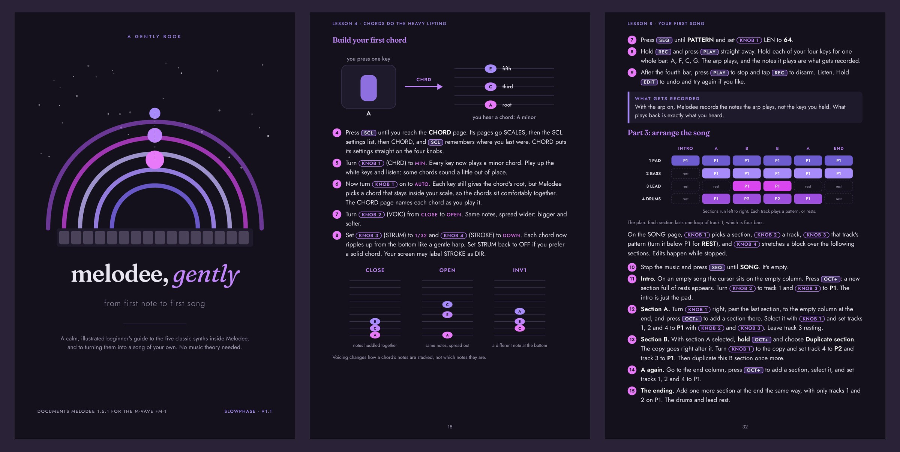
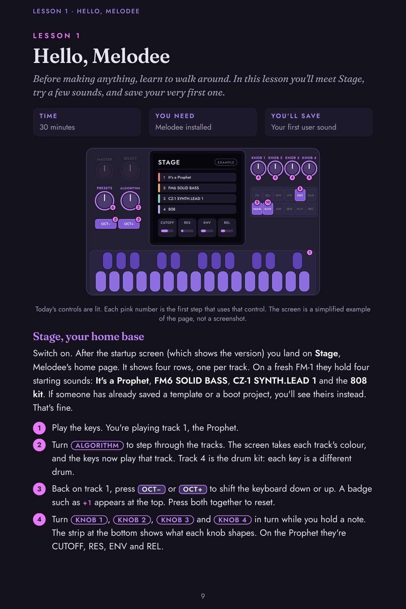
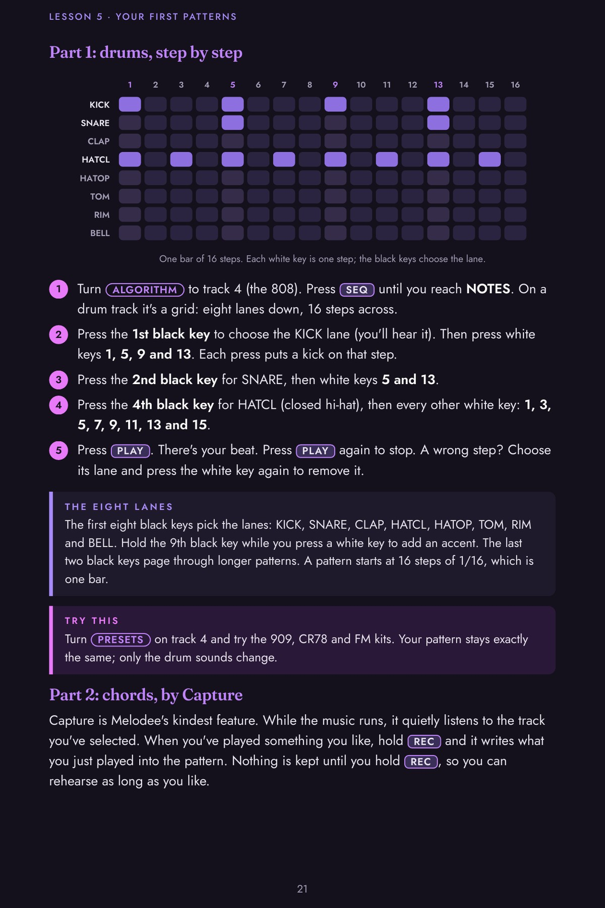

<p align="center">
  
</p>

<p align="center">
  <a href="LICENSE.md"></a>
</p>

*A free, illustrated beginner's guide to the M-VAVE FM-1 running [Melodee](https://github.com/keremimo/melodee), the multi-engine synthesiser and sequencer firmware by Ellic Studio.*

Not an equipment manual. Not a music-theory course. Just eight calm lessons with your FM-1, taking you from your first note to a short finished song of your own, built with five classic synths: Prophet, FM6, CZ-1, SID and Drum.

No prior musical knowledge required.

---

## Download the guide

| Edition | Best for | Size | Download |
| --- | --- | --- | --- |
| **iPad mini** (160 × 244 mm) | Portrait reading on the iPad mini, or any tablet or computer | 48 pages | [**Download the PDF**](https://github.com/slowphase/melodee-gently/releases/latest/download/Melodee-Gently.pdf) |
| **Editable source** | Revising the guide or adapting it, within the [licence](LICENSE.md) | ZIP archive | [**Download the source**](https://github.com/slowphase/melodee-gently/releases/latest/download/Melodee-Gently-source.zip) |

There is one edition, sized for comfortable reading on an iPad mini without zooming. The PDF is also in this repository as [`Melodee-Gently.pdf`](Melodee-Gently.pdf), and the source is in the [`source/`](source/) folder.

**Rebuilding the PDF** needs WeasyPrint 70.0 exactly; the pinned version is in [`source/requirements.txt`](source/requirements.txt):

```
cd source
python3 -m venv .venv && source .venv/bin/activate
pip install -r requirements.txt
python3 build.py
```

The text is in `content.py`, the drawings in `figures.py` and the look in `style.css`. Each lesson's panel numbers are generated from its own numbered steps (see [`source/docs/PANEL-NUMBERS.md`](source/docs/PANEL-NUMBERS.md)).

**Guide:** v1.1 · **Firmware documented:** Melodee 1.6.1 · **Status:** checked against the official manual and firmware source; hardware testing pending

Future versions will appear on the [Releases page](https://github.com/slowphase/melodee-gently/releases).

> **A note on this edition.** Every instruction was checked against the official Melodee 1.6.1 manual and, where the manual says less, against the 1.6.1 firmware source. The lessons have not yet been worked through on a physical FM-1. The behaviours still to confirm are listed [below](#version-compatibility). If something on your unit behaves differently from the book, please [tell us](#corrections-and-feedback).

---

## A look inside

<p align="center">
  
</p>

<p align="center">
  
  &nbsp;
  
</p>

<p align="center"><sub>A dark, purple look for evening sessions · each lesson lights up only the controls it uses · one project, built lesson by lesson into a song.</sub></p>

---

## What you'll learn

From Lesson 3 onwards you build one project. By the end it's a short finished song, about a minute long, with an intro, a middle and an ending:

1. **Hello, Melodee.** Stage, the sound browser and the five moves that work everywhere: save your first sound.
2. **Five instruments in one box.** A listening tour of Prophet, FM6, CZ-1, SID and the drum kits.
3. **Playing without wrong notes.** Start your project, keep every key inside a scale, and let the arpeggiator play.
4. **Chords do the heavy lifting.** One key, one chord: AUTO chords, voicings, strumming and a progression.
5. **Your first patterns.** Drums step by step, chords by Capture, and a bassline recorded live.
6. **Making it move.** Envelopes, an LFO and a recorded knob move.
7. **Space and polish.** A shared reverb, an echo on the lead, and a balanced mix.
8. **Your first song.** A busier drum pattern, an arpeggiated lead, and an arrangement with a finishing touch.

Plus installing safely, an optional bridge to the Akai MPC Sample, five engine cheat sheets, a reference of holds and pages, MIDI and Bluetooth, what changed since 1.5.1, troubleshooting (including "I can't hear anything") and a glossary.

## Who it's for

- Complete beginners to synthesisers, sequencers and music theory.
- New FM-1 owners who have installed Melodee and want to make music, not memorise menus.
- Anyone who'd like to finish a whole song on a pocket-sized instrument.
- MPC owners looking for a small, standalone source of original parts to sample.

---

## About Melodee and the FM-1

The **M-VAVE FM-1** is a pocket-sized, battery-powered synthesiser with a colour screen, seven endless knobs and 27 keys. **Melodee** is a free, open-source firmware for it by Kerem Kilic (Ellic Studio), based on Felucca by Leo Kuroshita and Hügelton Instruments. It offers five synthesis engines, eight tracks (four instrument tracks and four MIDI tracks), a 64-step sequencer with patterns and 64-section songs, scales and AUTO chords, effects, USB and Bluetooth MIDI, and USB audio.

- [Melodee on GitHub](https://github.com/keremimo/melodee)
- [Official Melodee manual](https://keremimo.github.io/melodee/webapp/manual/)
- [Web installer](https://keremimo.github.io/melodee/)

Please install and update Melodee using the official instructions, not this guide.

*Melodee, Gently* is an independent educational publication. It is not made, endorsed or supported by Ellic Studio, Hügelton Instruments or M-VAVE.

---

## Version compatibility

The guide has its own version number, separate from the firmware it describes. "v1.1" is the version of this book; "1.6.1" is the Melodee firmware it was written for.

| | Status |
| --- | --- |
| Guide | v1.1 |
| Documented firmware | Melodee 1.6.1 |
| Reference documentation | Official Melodee manual shipped with 1.6.1, and the 1.6.1 firmware source |
| Hardware testing | Pending |
| Newer firmware | Consult the [official manual](https://keremimo.github.io/melodee/webapp/manual/); Melodee changes quickly |

These behaviours still need confirming on a real FM-1:

- The on-screen wording of the STROKE label, the QNT values and the SCALES page's KNOB 1 label.
- How early a first chord can be played before Capture leaves it out.
- Punch FX step numbering on a 64-step section (START 49, END 64) and whether a newly added song section is selected automatically.
- MIDI clock out to an Akai MPC Sample, which Melodee's own release notes list as not yet tried with real gear.

The full list, with how each item was checked, is in [`source/docs/VERIFICATION.md`](source/docs/VERIFICATION.md).

---

## Corrections and feedback

Spotted a wrong button, a screen that looks different, a step that didn't work or a diagram mistake? Please [open an issue](https://github.com/slowphase/melodee-gently/issues/new) with your firmware version (it's on the FM-1's startup screen) and what you saw.

No question is too small, and beginners' reports are especially welcome: you are exactly who the book is for.

---

## Also in the series

- [**SLOOP, Gently**](https://github.com/slowphase/sloop-gently): the FM-1 with SLOOP firmware.
- [**MPC, Gently**](https://github.com/slowphase/mpc-gently): from first pad to first track on the Akai MPC Sample.
- [**Shrub, Gently**](https://github.com/slowphase/shrub-gently): wavetable synthesis on the FM-1 with SHRUB.

---

## Licence and credits

The guide is licensed under [Creative Commons Attribution-ShareAlike 4.0](LICENSE.md) (CC BY-SA 4.0), by slowphase. Credits for Melodee and its engines, and the font licences, are in [CREDITS.md](CREDITS.md).

M-VAVE, FM-1, Prophet-5, CZ-1, DX7, MPC and other names are trademarks of their respective owners.
