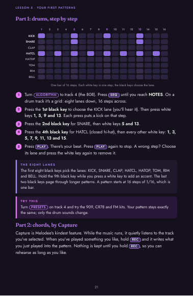
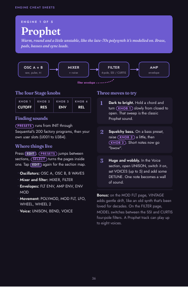

# Melodee, Gently

**From first note to first song**


A free, illustrated beginner's guide to **Melodee**, the multi-engine synth and sequencer firmware for the M-VAVE FM-1. Eight calm lessons take you through the five classic synths inside Melodee (Prophet, FM6, CZ-1, SID and Drum), scales and chords, patterns, movement, effects and, finally, a short finished song of your own. No music theory needed.

Part of the Gently series, alongside [SLOOP, Gently](https://github.com/slowphase/sloop-gently), [MPC, Gently](https://github.com/slowphase/mpc-gently) and [Shrub, Gently](https://github.com/slowphase/shrub-gently).

## Download

**[Melodee-Gently.pdf](Melodee-Gently.pdf)**: 48 pages, dark theme, sized for the iPad mini (160 × 244 mm).

| Book edition | Documents firmware |
|---|---|
| **v1.1** | **Melodee 1.6.1** |

Melodee changes quickly. If your FM-1's startup screen shows a different version, some names and screens may differ from this book. The [official Melodee manual](https://keremimo.github.io/melodee/webapp/manual/) always wins.

## What's inside

1. Hello, Melodee
2. Five instruments in one box
3. Playing without wrong notes
4. Chords do the heavy lifting
5. Your first patterns
6. Making it move
7. Space and polish
8. Your first song

Plus: installing safely, an optional bridge to the Akai MPC Sample, five engine cheat sheets, a reference of holds and pages, MIDI and Bluetooth, what changed since 1.5.1, troubleshooting and a glossary.

<p>


</p>

## How it was checked

Every instruction was checked against the official Melodee 1.6.1 manual and, where the manual says less, against the 1.6.1 firmware source. See [source/docs/VERIFICATION.md](source/docs/VERIFICATION.md). **It hasn't all been tried on a physical FM-1 yet.** If something doesn't match your unit, please [open an issue](https://github.com/slowphase/melodee-gently/issues) with your firmware version and what the screen showed.

## Rebuilding the PDF

The book is plain Python, HTML and CSS, rendered with WeasyPrint 70.

```sh
cd source
pip install -r requirements.txt
python3 build.py            # writes Melodee-Gently.pdf
```

The text is in `content.py`, the drawings in `figures.py` and the look in `style.css`. The panel numbers in each lesson are generated from its numbered steps (see `docs/PANEL-NUMBERS.md`).

## Licence and credits

The book is licensed under [Creative Commons Attribution-ShareAlike 4.0](LICENSE.md) (CC BY-SA 4.0), by slowphase. See [CREDITS.md](CREDITS.md).

Melodee is by Kerem Kilic (Ellic Studio), based on Felucca by Leo Kuroshita and Hügelton Instruments. This is an independent community guide, not affiliated with or endorsed by Ellic Studio, Hügelton Instruments, M-VAVE, Sequential, Casio, Akai or Commodore. M-VAVE, FM-1, Prophet-5, CZ-1, DX7, MPC and other names are trademarks of their respective owners.
